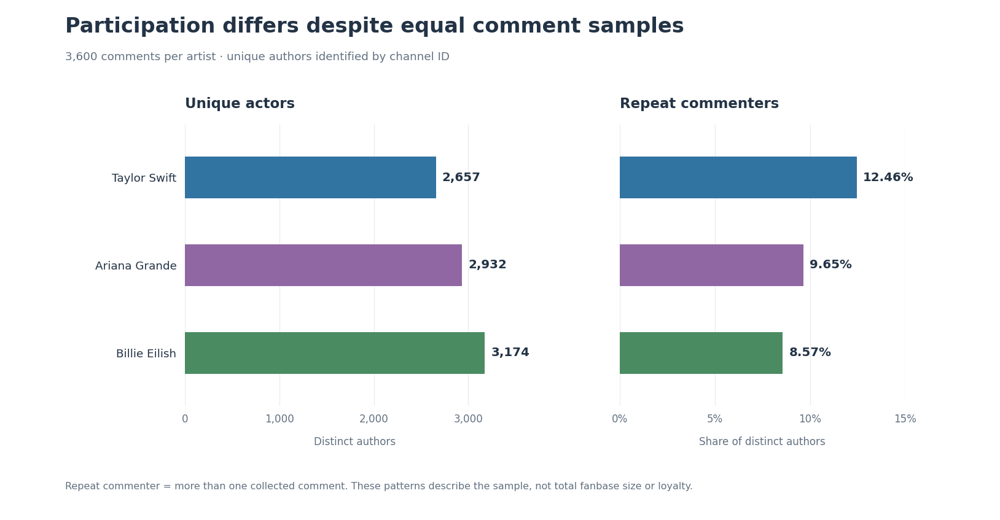
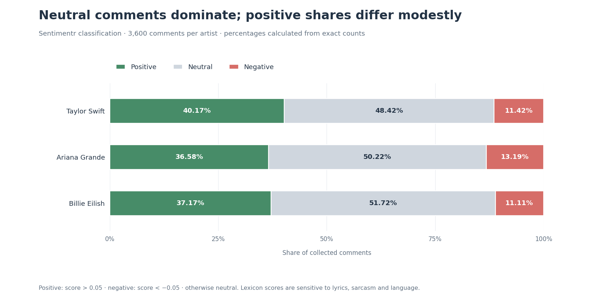
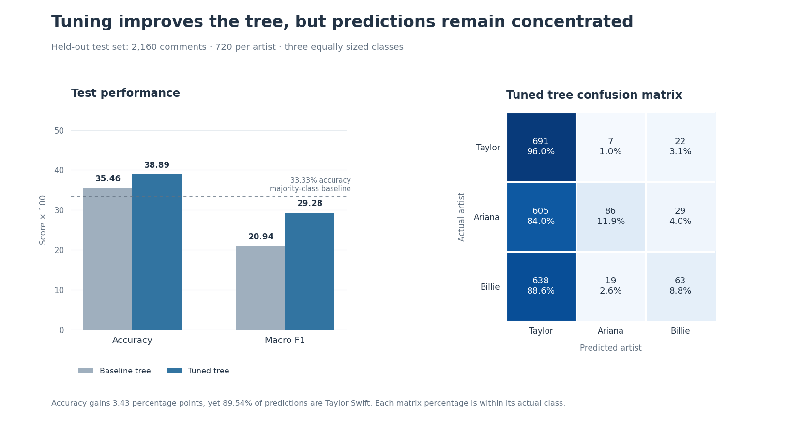

# YouTube Music Audience Analytics

**10,800 comments · 27 videos · 3 artists**

I used R to compare the YouTube discussions around Taylor Swift, Ariana Grande and Billie Eilish. The project examines who participates, what people discuss, and how the tone of comments differs. It also tests whether a decision tree can identify the artist from comment vocabulary.

[Written report](report/music-audience-analysis.pdf) · [Run the analysis](docs/reproduction.md) · [Methods](docs/methods.md) · [Power BI project](dashboard/README.md)

## What the data showed

### Equal comment counts hide different participation patterns



Billie's sample contained the most distinct commenters. Taylor's had fewer distinct authors but a higher proportion who posted more than once. These measure audience breadth and repeated participation within the sample; neither establishes total fanbase size or loyalty.

| Artist | Comments | Distinct commenters | Repeat commenters | Positive comments |
|---|---:|---:|---:|---:|
| Taylor Swift | 3,600 | 2,657 | 12.46% | 40.17% |
| Ariana Grande | 3,600 | 2,932 | 9.65% | 36.58% |
| Billie Eilish | 3,600 | 3,174 | 8.57% | 37.17% |

There were **8,713 distinct authors across all three samples**. Adding the artist totals would double-count people who commented on more than one artist.

### A frequent word is not automatically a positive opinion

“Love” occurred 451 times in Taylor's comments, 533 in Ariana's and 673 in Billie's. Reading the context changed the interpretation: **three lyric-copy comments contributed 45 of Ariana's occurrences, or 8.44%**. This is an inspected example, not a classification of every occurrence. [See the term results](results/tables/Q5_Top10_Terms.csv) and [context discussion](docs/methods.md#word-counts-and-context).



Taylor had the highest positive share under the selected sentiment thresholds. Around half of each sample was neutral. Lyrics, sarcasm and multilingual text affect automated scoring, so these differences are descriptive findings rather than a popularity ranking.

### Tuning helped, but the classifier remained weak



An 80/20 stratified split reserved **2,160 comments** for testing. Five-fold cross-validation selected the tree's complexity parameter. Accuracy improved from **35.46% to 38.89%**, compared with a **33.33% single-class baseline** on this balanced test set. The tuned model still predicted Taylor for 89.54% of test comments. I report this limitation alongside the improvement rather than treating the model as ready for use.

## What is included

| Area | Implementation |
|---|---|
| Collection and validation | YouTube API search, duplicate and missing-value checks, saved snapshots |
| Participation and networks | Distinct/repeat authors, weighted author–video graphs, PageRank, degree, betweenness and closeness |
| Text analysis | Custom preprocessing, term-document matrices, frequencies and weighted bigram networks |
| Community detection | Girvan–Newman and Louvain comparison on authors active across multiple videos |
| Sentiment | `sentimentr` polarity and NRC emotion-word counts |
| Modelling | Baseline/tuned `rpart` classification and three-topic LDA models per artist |
| Reporting | Exported tables, figures, written report and a two-page Power BI PBIP project |

## Run it

Open `youtube-comment-analysis.Rproj` in RStudio, or run these commands from the repository root:

```sh
Rscript scripts/check_project.R
Rscript scripts/setup.R
Rscript scripts/run_analysis.R participation
```

The quick check uses base R. The analysis runner prepares local `.RData` inputs from the included CSVs and writes new tables and figures. For the entire study, use `Rscript scripts/run_analysis.R all`; sentiment scoring, community detection and model fitting can take time. [Execution details and stage options](docs/reproduction.md).

## Data and scope

The original collection retained **400 comment records per video**, producing equal-sized artist samples. Video searches covered January 2024 to before 23 August 2026, used several official-release terms and requested English relevance. The cap discarded extra records and did not establish complete reply coverage. This is a bounded sample, not a representative sample of YouTube or of each fanbase.

The public snapshot replaces comment and author identifiers with stable labels, preserves cross-artist linkage and keeps text and row order intact. Free-text comments can still contain identifying details; this is pseudonymisation rather than a guarantee of anonymity. Raw API snapshots and OAuth caches are not part of the repository. [Data dictionary](data/README.md).

The dashboard includes native PBIP report/model definitions, DAX measures and portable embedded data. The repository images are **analytical layout previews**. A native Power BI Desktop refresh/filter test is not claimed. [Opening instructions and verification scope](dashboard/README.md).

## Next improvements

- Set a top-level comment target and retain available replies rather than enforcing an exact record cap.
- Match video formats and collection periods, and document search exclusions.
- Manually validate a sentiment sample and distinguish lyric quotation from personal reaction.
- Evaluate vocabulary selection inside cross-validation and hold out complete videos or authors.
- Compare the tree with a sparse-text classifier and assess topic stability across topic counts.

**Author:** Mohammed Baquaysh — Data Science and Business (Marketing), Griffith University.

The scripts retain their original question numbers for traceability. Presentation recordings and slides are excluded.
