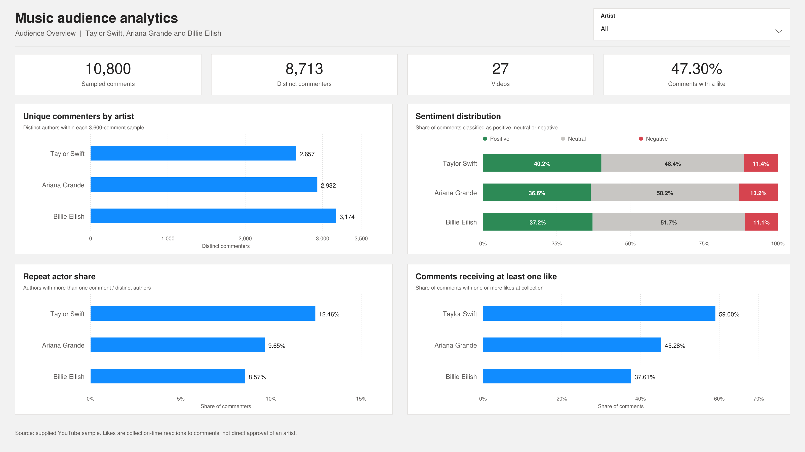
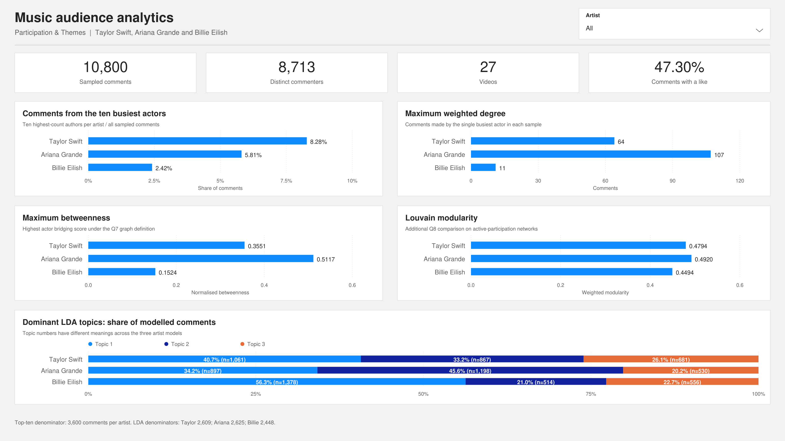

# Power BI audience dashboard

Open **[3032ICT_Music_Dashboard.pbip](3032ICT_Music_Dashboard.pbip)** with Power BI Desktop on Windows. Download/clone the whole repository first; the `.pbip`, `.Report` and `.SemanticModel` folders must stay together. PBIP is the project source format. A `.pbix` export is not included.

The semantic model embeds its CSV snapshots in Power Query, so it does not rely on a path to the author's computer. `Source_Data/` contains readable copies. Public actor/comment labels are used both in these files and in the embedded model.

## Pages

| Page | Analytical charts |
|---|---|
| Audience Overview | Distinct commenters, sentiment composition, repeat-actor share, comments receiving a like |
| Participation & Themes | Top-ten author concentration, maximum weighted degree, maximum betweenness, Louvain modularity, dominant LDA-topic shares |

Each page also includes four cards and an artist dropdown. The intended selection is shared across pages. [DAX measures](Q12_Measures.dax) are included as readable source.

### Layout previews

These are analytical previews rendered from the supplied data, **not screenshots captured in Power BI Desktop**.

## Two useful comparisons

- Ariana's busiest author posted 107 comments, but Taylor's ten busiest authors collectively supplied more comments: 298 versus 209. The single most active author and overall concentration answer different questions.
- Ariana's comments were more likely than Billie's to receive a like (45.28% versus 37.61%), although Billie's positive-text share was slightly higher. Comment reactions and automated sentiment do not have the same meaning.

## Native-app checks

The repository contains report definitions, model relationships, DAX and embedded data. JSON/data checks do not execute DAX or establish Desktop functionality. After opening, verify:

1. Both pages load and Refresh succeeds.
2. All-artists cards show 10,800 comments, 8,713 distinct authors, 27 videos and 47.30% comments with a like.
3. Selecting Taylor gives 3,600 comments, 2,657 authors, nine videos and 59.00% with a like.
4. Artist selections are retained when switching pages and can be cleared.
5. Topic/sentiment aggregate charts filter by artist. They are not configured to filter individual comment rows by topic or sentiment.

No completed native Power BI Desktop opening, refresh or filter test is claimed here.
